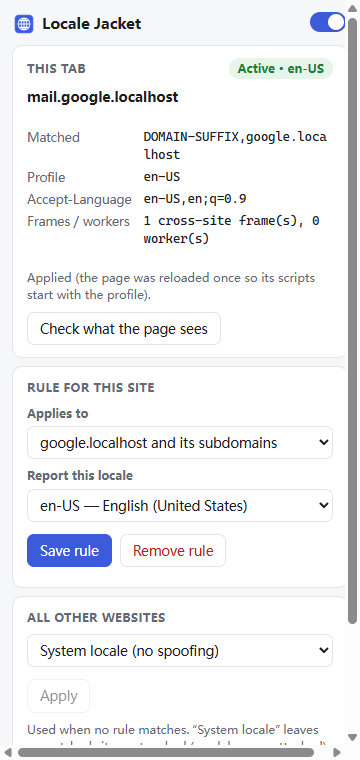
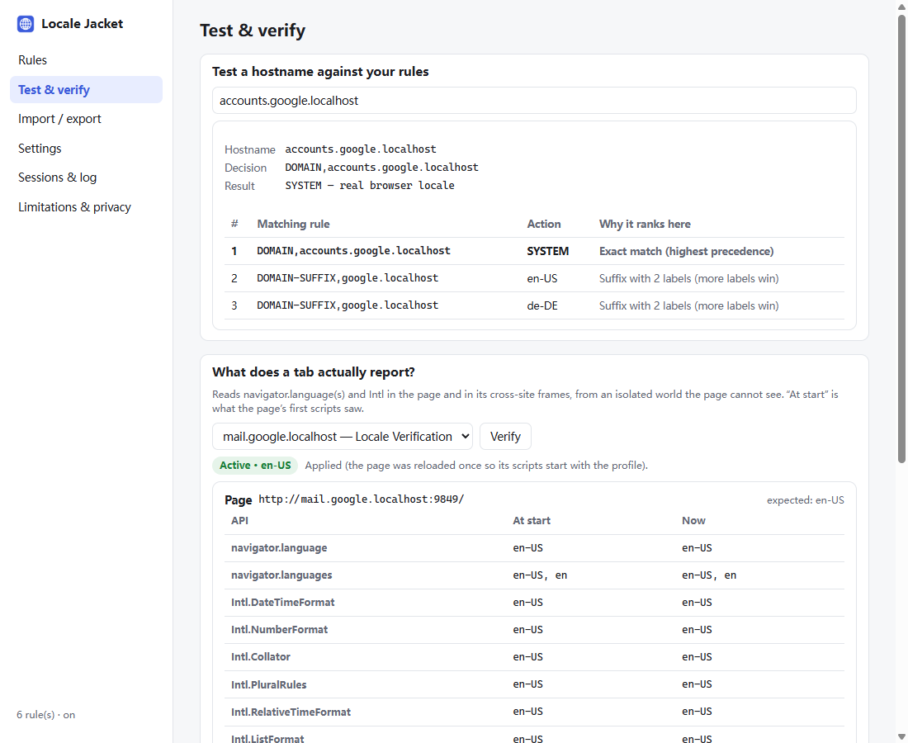

# Locale Jacket

A Chrome/Edge (Manifest V3) extension that makes websites see a **different browser locale per site** (for example `en-US` on google.com and `ja-JP` on apple.com) while the browser's own UI language stays unchanged (for example Simplified Chinese).

It automates what **DevTools ▸ Sensors ▸ Locale** does, applying it to every matching tab without opening DevTools. Routing works like Clash, sing-box or Shadowrocket rules: `DOMAIN`, `DOMAIN-SUFFIX`, `DOMAIN-KEYWORD`, `DOMAIN-REGEX`, `GEOSITE`, `IP-CIDR`, `IP-CIDR6`, `IP-ASN` and `GEOIP`, with `SYSTEM`/`DIRECT` exceptions and a default action.

| What a site observes | How it is spoofed | Coverage |
|---|---|---|
| `Intl.*` (DateTimeFormat, NumberFormat, Collator, PluralRules, RelativeTimeFormat, ListFormat, DisplayNames, Segmenter, `toLocaleString` …) | `Emulation.setLocaleOverride` (Chrome's ICU default locale) | Page, same-site frames, cross-site frames, dedicated workers |
| `navigator.language`, `navigator.languages` | `Emulation.setUserAgentOverride` with **only** `acceptLanguage` (the User-Agent string and UA client hints are left untouched) | Page, frames, dedicated workers |
| HTTP `Accept-Language` | The same override, a corrected header on the paused document request, and a `declarativeNetRequest` rule for top-level documents | Documents, subresources, `fetch()`, worker requests |
| Time zone, geolocation | `Emulation.setTimezoneOverride` / `setGeolocationOverride`, **off by default**, per rule | Page and frames |

No JavaScript APIs are monkey-patched. Everything was checked against real Chrome 155 and Edge 155; see [research/FINDINGS.md](research/FINDINGS.md).

<p>


</p>

## Install

Requirements: Node.js 20+ (only to build), and Chrome or Edge 125 or later (developed and tested on 155).

```sh
npm install
npm run build        # produces dist/
```

**Chrome:** open `chrome://extensions`, turn on **Developer mode**, click **Load unpacked** and select the `dist/` folder.
**Edge:** open `edge://extensions`, turn on **Developer mode**, click **Load unpacked** and select `dist/`.

Pin the extension so its badge (for example `EN` or `JA`) shows which profile the current tab uses. To use it in private windows, enable **Allow in Incognito** on the extension's details page.

`npm run package` creates `release/locale-jacket-<version>.zip` for uploading to a store.

`npm run crx` creates a signed `release/locale-jacket-<version>.crx` using Chrome's own packer.
- The signing key is generated on first use in `keys/locale-jacket.pem` (git-ignored) and reused afterwards. It determines the extension ID, so back it up.
- Chrome and Edge only install `.crx` files from outside their stores when an enterprise policy allows it (`ExtensionInstallAllowlist` / `ExtensionInstallForcelist`). For personal use, **Load unpacked** is the way to install.

### What to expect

- On first install the **example preset** from the specification is active:

  | Rule | Result |
  |---|---|
  | `DOMAIN-SUFFIX,google.com` | `en-US` |
  | `DOMAIN-SUFFIX,openai.com` | `en-US` |
  | `DOMAIN-SUFFIX,apple.com` | `ja-JP` |
  | `DOMAIN-SUFFIX,yahoo.co.jp` | `ja-JP` |
  | `DOMAIN,accounts.google.com` | `SYSTEM` |
  | default | `SYSTEM` |

  Edit or delete these rules freely.
- While any tab is being spoofed, Chrome shows **"Locale Jacket started debugging this browser"**. This is Chrome's security notice for the `chrome.debugger` API. The extension does not hide it. Clicking **Cancel** on it pauses Locale Jacket until you press **Resume** in the popup. If you accept the trade-off, you can hide it yourself; see [Hiding the debugging banner (optional)](#hiding-the-debugging-banner-optional).
- The browser UI language, Chrome's language settings and other extensions are never changed.

### Hiding the debugging banner (optional)

> **Security trade-off.** Chrome shows that banner for *every* extension that uses the `debugger` permission. Hiding it hides it for all of them, not just Locale Jacket. Do this only if you trust every installed extension.

Chrome has no setting, policy or `chrome://flags` entry for this; checked against all 666 flags in Chrome 155 and 213 in Edge 155. The only option is the launch switch `--silent-debugger-extension-api`. Chrome reads it only when its **first** process starts, so every way Chrome can be launched needs it. The extension never sets it.

[`tools/chrome-banner-flag.ps1`](tools/chrome-banner-flag.ps1) (Windows, PowerShell 5.1 or 7) does this for you:

```powershell
pwsh -File tools\chrome-banner-flag.ps1                   # status only: shortcuts, link handler, running browser
pwsh -File tools\chrome-banner-flag.ps1 -Apply            # add the switch (Chrome)
pwsh -File tools\chrome-banner-flag.ps1 -Apply -Browser Both   # Chrome and Edge
pwsh -File tools\chrome-banner-flag.ps1 -Revert           # undo, from the backup
```

**What `-Apply` changes:**
- Adds the switch to every Chrome (or Edge) shortcut on the taskbar, Start menu, desktop and Quick Launch. Existing arguments such as `--profile-directory` are kept.
- Adds it to the per-user http/https link handler (`HKCU\Software\Classes\ChromeHTML\shell\open\command`, or `MSEdgeHTM` for Edge), so links opened from other apps also start the browser with it.
- Saves the original values to `%LOCALAPPDATA%\LocaleJacket\banner-flag-backup.json`, which is what `-Revert` restores.
- Shortcuts for all users (under `%ProgramData%` or the Public desktop) need an elevated PowerShell. Without one they are skipped with a warning.

**After applying:**
1. Quit Chrome completely: close every window and the tray icon, and turn off *Settings ▸ System ▸ Continue running background apps*. Otherwise a Chrome already running without the switch is reused.
2. Start Chrome from a shortcut.
3. Check `chrome://version` ▸ **Command Line**, or run the script again without arguments; it should say `started WITH the flag`.

Chrome updates and "make default browser" can rewrite the shortcuts or the link handler, so re-check after updating. To do it by hand instead, add ` --silent-debugger-extension-api` after `chrome.exe` in each shortcut's **Target**, and in the link handler before `--single-argument %1`.

## Interface language

The popup and options page are available in **English** and **简体中文**. By default they follow the browser’s UI language; change it in *Options ▸ Settings ▸ Display language*. This only affects Locale Jacket’s own pages, never what websites see. Detailed input-validation messages and the activity log are in English.

## Using it

**Popup** (toolbar icon)
- Turns spoofing on or off for all sites.
- Shows the current tab: matched rule, profile, status, and a **Check what the page sees** button that reads the live values and the values the page's first scripts saw.
- Adds or changes a rule for the current site (its suffix, or the exact host) or excludes it with *System locale*.
- Sets the default for all other websites.

**Options page** (*Manage rules…*)
- **Rules:** enable or disable, reorder, edit, delete. Each rule's effective rank is shown, and duplicates, conflicts and redundant or no-op rules are flagged.
- **Rule editor:** match type (`DOMAIN-SUFFIX` by default), domain or keyword (IDN and pasted URLs accepted), and either *SYSTEM* or a full locale profile:
  - locale (presets or any validated BCP 47 tag)
  - `navigator.languages` and the resulting Accept-Language
  - optional time zone and geolocation
  - priority and note
- **Test & verify:** type a hostname and see which rules match and why, or pick an open tab and see what every locale API reports in the page and its cross-site frames.
- **Import / export:** JSON or YAML, replacing or merging.
- **Settings:**
  - frame mode
  - whether the debugger session is kept after leaving a spoofed site
  - the one-time reload when the profile arrived late
  - the DNR header rules
  - worker overrides
- **Sessions & log:** which tabs are being debugged, their status, and an in-memory activity log.

## Rules

```yaml
rules:
  - type: DOMAIN-SUFFIX        # google.com and every subdomain (label boundaries)
    domain: google.com
    locale: en-US
  - type: DOMAIN               # exact host only
    domain: accounts.google.com
    action: SYSTEM             # keep the real browser locale (DIRECT is an alias)
  - type: DOMAIN-KEYWORD       # hostname contains the text
    keyword: microsoft
    locale: en-GB
  - type: DOMAIN-SUFFIX
    domain: apple.com
    locale: ja-JP
    languages: [ja-JP, ja, en]   # optional; default [locale, base language]
    timezone: Asia/Tokyo         # optional, off unless set
    geolocation: { latitude: 35.68, longitude: 139.69, accuracy: 100 }   # optional
    priority: 0                  # optional tie-breaker (higher wins)
    enabled: true
  - DOMAIN-SUFFIX,yahoo.co.jp,ja-JP   # Clash-style compact form is accepted too
  - MATCH,SYSTEM                       # compact form of the default
default:
  mode: SYSTEM                 # or: mode: PROFILE + locale/languages/…
```

**Matching**
- Case-insensitive, with trailing dots ignored.
- Internationalized domain names work in either form: `例子.测试` and `xn--fsqu00a.xn--0zwm56d` are the same rule.
- `DOMAIN-SUFFIX` matches on DNS label boundaries: `google.com` matches `google.com` and `mail.google.com`, but never `fakegoogle.com` or `google.com.evil.org`.
- Suffix rules never match IP addresses; use `DOMAIN` for those.

**Precedence** (deterministic; the first difference decides)
1. Rule type: `DOMAIN` (exact) › `DOMAIN-SUFFIX` › `DOMAIN-KEYWORD` › `DOMAIN-REGEX` › `GEOSITE` › `IP-CIDR`/`IP-CIDR6` › `IP-ASN` › `GEOIP`. Hostname rules always beat IP rules, because the hostname is always known and the server address may not be.
2. Within a type, the most specific wins: the suffix with the most labels, or the IP range with the longest prefix.
3. Higher `priority` wins.
4. Earlier position in the list wins.
5. The default applies only when nothing matches.

So `DOMAIN,accounts.google.com → SYSTEM` overrides `DOMAIN-SUFFIX,google.com → en-US`, whatever the list order.

### IP and GEO rules

```yaml
rules:
  - DOMAIN-REGEX,^(.+\.)?example\.(com|org)$,fr-FR   # JavaScript regex on the hostname
  - GEOSITE,google,en-US                # category from geosite.dat; @attr filters: apple@cn, geolocation-!cn
  - IP-CIDR,17.0.0.0/8,en-US            # server address in range
  - IP-CIDR6,2400:cb00::/32,en-US
  - IP-CIDR,192.168.0.0/16,SYSTEM,no-resolve   # only when the site is opened by IP address
  - IP-ASN,13335,en-US                  # autonomous system (AS13335 is also accepted)
  - GEOIP,JP,ja-JP                      # server country
  - GEOIP,LAN,SYSTEM                    # private/loopback/link-local, built in
```

- **Server address.** Extensions cannot resolve DNS, and asking a DNS-over-HTTPS service would send every hostname you visit to a third party. So IP rules use the address Chrome actually connected to, taken from `webRequest` and kept in memory for the session only.
  - On the first visit to a host that address is known only once the server answers. If an IP rule then changes the decision, the page is flagged and reloaded once.
  - Later visits are decided before the request is sent.
  - `no-resolve` rules only ever look at hosts that are IP literals.
- **Data sets.** `GEOSITE`, `GEOIP` country rules and `IP-ASN` need data files that are **never downloaded automatically**. In *Options ▸ Data sets*, either download them from an editable URL or import a local file. They are stored in the extension's IndexedDB.

  | Data set | Default source | Format |
  |---|---|---|
  | GeoSite | MetaCubeX `geosite.dat` (≈4 MB, via jsDelivr) | v2ray/mihomo `geosite.dat`; Loyalsoldier's also works |
  | GeoIP | MetaCubeX `country-lite.mmdb` (≈0.4 MB) | MaxMind DB, GeoLite2-Country schema; special codes such as `GOOGLE` work when the file has them |
  | ASN | MetaCubeX `GeoLite2-ASN.mmdb` (≈9 MB) | MaxMind DB, GeoLite2-ASN schema |

  GeoLite2 data is © MaxMind (CC BY-SA 4.0), the domain lists come from v2fly/domain-list-community. A rule whose data set is missing simply does not match, and the UI says so. Note that the community GeoIP files (MetaCubeX, Loyalsoldier) give some networks a special code *instead of* their country: 8.8.8.8 is `GOOGLE`, 1.1.1.1 is `CLOUDFLARE`. A `GEOIP,US` rule therefore does not match Google DNS; add `GEOIP,GOOGLE` if you want it to. *Options ▸ Test & verify* shows the code an address gets.
- **First-request header.** `GEOSITE` domain lists (up to 20,000 domains) are mirrored into declarativeNetRequest for the first request's `Accept-Language`. IP and regex rules apply through the debugger only.

**Accept-Language** is always derived from `languages` the way Chrome does it (`en-US,en;q=0.9`, `…;q=0.8`, and so on). An `acceptLanguage` value given on import must agree with `languages`, or you get a warning.

## How it works (short version)

For every tab that needs a profile, the background service worker:

1. Attaches `chrome.debugger` to the tab and enables two things:
   - a **navigation gate**: `Fetch.enable` for document requests
   - **auto-attach** to cross-site iframes and dedicated workers, which are paused until they are configured
2. Handles each top-level navigation at the gate:
   - **Same profile as now:** the request continues, with `Accept-Language` corrected if needed.
   - **Different profile:** Chrome only delivers emulation commands to the next document after its scripts have started. So the navigation is aborted before anything reaches the server, the new profile is applied, and the navigation is re-issued (Referer kept, one history entry). The new page then starts with the right values.
3. Configures each cross-site iframe or worker before it runs a single script.
4. Mirrors the rules into `declarativeNetRequest` header rules, so even a tab that cannot be debugged yet (for example a URL typed into a New Tab Page) sends the right `Accept-Language` for its first document.
5. Confirms with a document-start probe (in an isolated world the page cannot see) that the page's first scripts saw the right values. If they didn't, the tab is flagged *Reload needed* and, for fresh navigations, reloaded once.

Details: [docs/ARCHITECTURE.md](docs/ARCHITECTURE.md).

## Verify it yourself

- **Options ▸ Test & verify:** pick a tab and compare every API with the expected locale, at document start and now.
- **Local verification page:** run `npm run serve:verify`, then open `http://google.localhost:8787/`, `http://apple.localhost:8787/` or `http://example.localhost:8787/`. All `*.localhost` names resolve to your machine.

  Each page shows:
  - the `Accept-Language` the server received
  - every locale API at document start and after load
  - a dedicated worker
  - a same-site iframe and a cross-site iframe

  Add `?expect=en-US` to highlight mismatches. To try your own rules there, add rules for `google.localhost` and the like.
- **Any real website:** paste [verify/snippet.js](verify/snippet.js) into the DevTools console. It prints the `console.table` from the specification and more.

## Limitations (summary)

These are documented in the extension (*Options ▸ Limitations & privacy*) and in [docs/LIMITATIONS.md](docs/LIMITATIONS.md).

- **Restricted pages** are never spoofed: `chrome://`, `edge://`, the New Tab Page, the Chrome Web Store / Edge Add-ons, and anything blocked by policy.
- **Pages that start before debugging is possible.** The first page opened from the New Tab Page starts loading before Chrome allows debugging. Its HTTP header is still correct (DNR), and the page is reloaded once so its scripts see the profile.
- **POST navigations** that change profile cannot be re-issued; they are flagged *Reload needed*.
- **The `Intl` locale is per renderer process.** Two tabs of one site, or one cross-site iframe embedded in two tabs with different profiles, can share a process, and then only one locale can win. Such conflicts are reported as *Partial*, never hidden. While a tab is spoofed, DevTools ▸ Sensors ▸ Locale cannot override it, and vice versa.
- **Service workers and shared workers** are not overridden.
- **Already-loaded pages** (pages restored from the back/forward cache, prerendered pages, and tabs open before a rule changed) keep the values their scripts already read until reloaded. They are re-aligned when shown and flagged.

## Privacy and permissions

Everything runs locally. There is no server, account, telemetry or analytics. The extension makes no network requests of its own, except data-set downloads you start yourself in *Options ▸ Data sets*, from the URL shown there. Rules are stored in `chrome.storage.local`. The activity log lives in memory only and contains hostnames, not URLs.

| Permission | Why |
|---|---|
| `debugger` | Chrome's locale and Accept-Language emulation (the core feature) |
| `webNavigation` | Know when a tab navigates, to attach and reconcile in time |
| `declarativeNetRequestWithHostAccess` + `http://*/*`, `https://*/*` | Correct `Accept-Language` on the first document request; host access also lets the popup see the current tab's hostname |
| `storage` | Save your rules |
| `webRequest` | Read the server address of page loads, for IP rules (observe only; registered only while IP rules exist) |

## Development

```sh
npm test            # build + unit tests (rule engine, YAML, import/export, DNR, session lifecycle)
npm run e2e         # build + end-to-end tests in real Chrome (headless), using the verify server
npm run e2e:edge    # the same in Microsoft Edge
node e2e/run.mjs --headful            # watch it run
npm run screenshots # UI screenshots into e2e/artifacts/
npm run typecheck
```

The end-to-end suite starts the browser with `--lang=zh-CN`, loads `dist/` through the DevTools protocol (`Extensions.loadUnpacked`), and drives pages on `*.localhost` hostnames. It asserts what the page's **first script** observed, which headers the server received, and what frames and workers saw.

```text
src/shared/      rule engine, domain/IDN handling, locale profiles, YAML, import/export, DNR compiler
src/background/  service worker: per-tab debugger sessions, navigation gate, overrides, probe
src/popup/       toolbar popup
src/options/     options page and rule editor
src/ui/          small DOM helpers shared by the pages
static/          manifest, HTML/CSS, icons
test/            unit tests (node:test)
e2e/             real-browser tests and screenshot script (dependency-free CDP client)
verify/          local verification server, pages and console snippet
research/        probe extension + scripts behind research/FINDINGS.md
```

Troubleshooting: [docs/TROUBLESHOOTING.md](docs/TROUBLESHOOTING.md).

## 中文快速说明

1. `npm install && npm run build`
2. 在 `chrome://extensions` 或 `edge://extensions` 打开“开发者模式”，点击“加载已解压的扩展程序”，选择 `dist/` 目录。
3. 默认规则：google.com / openai.com → en-US，apple.com / yahoo.co.jp → ja-JP，accounts.google.com 保持系统语言，其余网站不修改。可在弹窗或“选项”页面中修改规则，也可以导入或导出 JSON/YAML（支持 `DOMAIN-SUFFIX,google.com,en-US` 这种 Clash 写法）。
4. 生效时 Chrome 顶部会显示“Locale Jacket 已开始调试此浏览器”。这是 Chrome 的正常安全提示。点击“取消”会暂停扩展，之后可在弹窗中点击 Resume 恢复。
5. 浏览器界面语言（简体中文）不会被修改。

## License

GPL-3.0. See [LICENSE](LICENSE).
